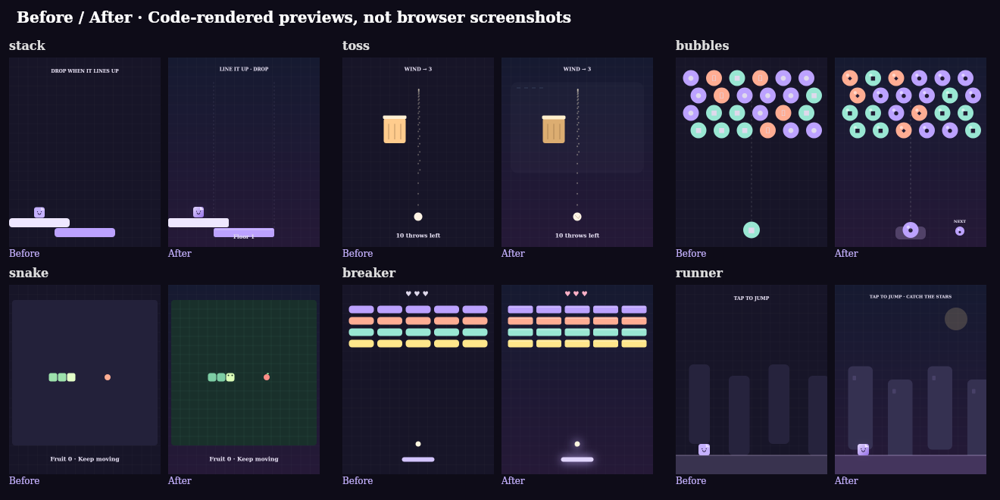

# Studio Arcade audit and improvements — 13 October 2026

Scope: ten games at https://pdf-studio.in/lab/arcade. Baseline main commit `c9984b8b25ce4d71808f5ad539bcb137fefa42be`; proposed changes in PR #188. Production links below show the baseline until this PR is approved and deployed.

## Evidence boundaries

Before editing, all ten production routes were opened in the desktop cloud browser. Start, one basic action and Pause were exercised. This establishes basic interaction, not complete-round correctness. A Memory Match automation run timed out waiting for a card cooldown; a later DOM read showed the cooldown cleared. No persistent lock was demonstrated. Full manual wins/losses, every input method, exit/resume combinations and physical-device touch have not been exhaustively tested.

Automated seeded engine checks cover complete win/loss conditions, restart through new state, 2048 merge/undo/loss, sliding solvability, Memory Match cooldown/win, toss completion, stack overlap, bubble clusters, Snake growth/reversal/collision, breaker lives/win, timed odd-one completion and runner collisions. SSR checks render the directory and every initial screen. These are not browser, mobile-emulation or real-device tests.

## Per-game findings and implemented fixes

| Game / exact test URL | Finding and severity | Evidence | Implemented improvement / test |
| --- | --- | --- | --- |
| [Buddy Stack](https://pdf-studio.in/lab/arcade/buddy-stack) | Medium: abrupt tower framing and generic preview weaken alignment feedback. | `lib/arcade-draw.ts` baseline immediate camera offset; production Drop responded. | Smoothed camera, alignment rails, perfect-drop particles and Buddy reaction. Original overlap/perfect/miss tests retained. |
| [Paper Toss](https://pdf-studio.in/lab/arcade/paper-toss) | Medium: direct throw gesture unavailable; out-of-bounds misses retained old wind/bin. | Baseline engine action used fixed launch velocity; miss branch lacked target reset. | Upward swipe controls throw velocity; button aim remains; wind/bin reset consistently. Dotted path labelled as button-throw prediction. |
| [Merge 2048](https://pdf-studio.in/lab/arcade/merge-2048) | Medium: Undo restored board/score but left move count inflated; all-zero saved board accepted. | Baseline Undo and restore branches in `lib/arcade-engine.ts`. | Undo decrements moves, restores score; rejects empty saved boards; subtle tile pulse. Existing valid saves and storage keys preserved. |
| [Bubble Pop](https://pdf-studio.in/lab/arcade/bubble-pop) | High: nearest free slot could teleport a shot into a disconnected cell; unsupported bubbles never dropped. | Baseline `attachBubble` considered every empty slot with no adjacency constraint. | Attach only near supported cells; flood from ceiling and drop loose clusters; next-colour preview, direct release-to-shoot and shape-coded colours. Targeted connected/detached tests pass. |
| [Snake Sprint](https://pdf-studio.in/lab/arcade/snake-sprint) | High: two quick direction inputs could overwrite the first intended turn. | Baseline had a single queued direction checked against current direction. | Two-turn FIFO validated against last queued direction; original reversal guard retained; clearer board/head/fruit. Rapid-turn test passes. |
| [Memory Match](https://pdf-studio.in/lab/arcade/memory-match) | Low: plain card changes and incorrect generic keyboard guidance. | Baseline JSX/help; basic live flip responded, automation cooldown timing limitation above. | Flip/match feedback, accurate Tab/Enter/Space help; duplicate-tap lock and reveal timing preserved. Complete seeded match round passes. |
| [Neon Brick Breaker](https://pdf-studio.in/lab/arcade/neon-breaker) | High: broad paddle rescue zone could bounce a ball already below paddle; rectangular hit expansion caused corner false positives. | Baseline engine paddle y445–475 and expanded brick AABB. | Swept paddle crossing, circular brick-distance test, fixed physics substeps; neon visuals/short trail/fragments. Below-paddle and corner tests pass. |
| [Tap the Odd One](https://pdf-studio.in/lab/arcade/odd-one) | Low: same pair of symbols throughout a round reduces variety. | Baseline JSX used fixed filled/hollow diamond. | Progressively varied shape pairs with bounded difficulty; actual glyph and row/column accessible labels. Timer/penalty mechanics preserved. |
| [Sliding Puzzle](https://pdf-studio.in/lab/arcade/sliding-puzzle) | High: restored board permutation could be impossible to solve. | Baseline restore validated unique numbers, not parity. | Reject unsolvable restored arrangements, retain valid saves, animate legal tile movement. Permutation/parity tests pass. |
| [Buddy Runner](https://pdf-studio.in/lab/arcade/buddy-runner) | Medium: jump just before landing ignored; collision box wider than drawn character. | Baseline ground-only action and obstacle bounds in engine. | Brief jump buffer and tighter body box; skyline, stars and Buddy/trail feedback. Landing-buffer and original collision checks pass. |

## Shared changes

- Ten native SVG miniature scenes replace generic catalogue symbols; search and genre filters remain.
- One obvious Play/Resume overlay; Pause, Restart, Sound and Undo retain predictable controls. Longer instructions start collapsed. Escape pauses even when a button has focus.
- Logical 400×500 canvas coordinates preserved; backing resolution follows DPR up to 2×. Pointer conversion handles CSS scaling. No forced 4K rendering.
- Aim changes do not publish React snapshots or write saved state. Snapshot signatures update for meaningful state changes, with timer seconds rather than 10 Hz timer-only updates.
- Physics uses 1/120-second substeps with at most 0.25 seconds catch-up; RAF reset on pause/resume prevents hidden-time jumps. Bounded particles do not consume gameplay RNG.
- Reduced-motion disables decorative trails, particles and tile motion; essential game movement remains. Audio suspends while paused/hidden and catches unavailable audio errors.
- Compact mobile stage, safe-area padding and short-landscape two-column rules. These rules were inspected/tested as source, not validated on physical phones.
- Changes remain in Arcade components/styles/engine and related quality/sitemap fingerprints. PDF/image processing, dependencies, workers, assets and storage keys are unchanged. Existing ad exclusion remains.

## Visual and performance evidence

This comparison renders baseline and proposed drawing code with the same seed using native CPU canvas. It is not a browser screenshot or proof of mobile layout. It has no mouse pointer. SVG catalogue artwork and DOM board animations require browser verification after a review build is available.

`arcade-evidence/render-benchmark.json` records median time per static draw after 20 warmups and five batches of 100 draws at logical 400×500. New gradients/shadows cost more CPU; this measurement is a drawing-cost comparison, not browser FPS or Android certification. Capped DPR, fewer React updates and bounded effects limit work, but net real-device performance remains unmeasured.

## Validation and release gate

Local PASS: `node checks/verify-arcade.mjs`, `node checks/verify-arcade-ui.mjs`, `node checks/verify-arcade-improvements.mjs`; strict Arcade subset TypeScript; targeted ESLint including sitemap generator. Full-repository lint, TypeScript, PDF/image checks and production build are delegated to the existing GitHub quality workflows; inspect PR checks for their final result.

Remaining: updated desktop/phone browser screenshots; real Android/iOS gestures, landscape/keyboard/safe areas; measured before/after device FPS; full manual rounds and every pause/leave/resume path. A local browser preview was unavailable in this environment, so no after-layout or real-device claims are made. PR remains separate from main pending review.

## How to test the proposed build

After the PR is deployed to an approved preview or production build, use the exact links above. Start each game, perform its primary action, pause/resume, restart and leave. Specifically: rapid Up→Left Snake turns; upward swipe throws; loose Bubble Pop clusters; paddle edge/corner collisions; runner jump just before landing; 2048 Undo move count and reload restore; legal sliding motion and reload; Memory Match mismatched cooldown; timed Odd One penalties; Stack perfect/edge/missed drops. Repeat with keyboard, mouse and actual touch. Check saved puzzle restoration with storage unavailable. Confirm PDF/image upload→process→preview→download independently.