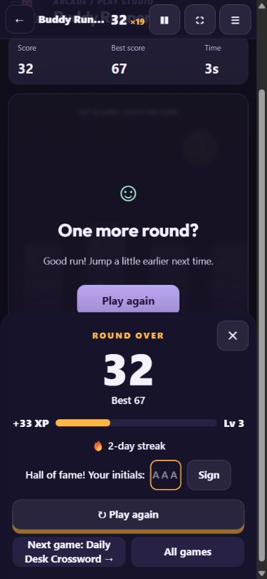

# Arcade continuation — 31 October 2026

## Scope and release state

Arcade only. PRs #225 and #226 were already merged before this continuation. Main was `7a277fa3c550de4452bfd20eb13db2257ab8bf46`. GitHub reports its Cloudflare Workers build as failed. The deployed site still exposes the old shared frame: on the live initial ready screen Pause is enabled, while current source disables it; game titles, scores and native controls are duplicated. Do not equate merged code with deployed code. Cloudflare build logs were not available through a connected API. Two local build-gate failures were independently reproduced and fixed below; this does not prove no other deployment blocker remains.

The pasted report described another workspace with six rebuilt games and 106 tracking rows. Those files were not attached. None of those implementation or playtest claims is adopted as evidence here.

## Verified inventory and evidence

`coverage-2026-10-31.json` and its Markdown companion contain every actual active URL, catalogue file, mechanic, reference status, evidence, issue, implementation state and acceptance check. Source inventory: 100 active unique slugs and 18 retired. Neither uniqueness nor an HTTP success establishes distinct, complete gameplay.

Live desktop outcomes in this continuation:

1. **Buddy Stack:** manual timed drops; loss after score 3, result card; replay scored 1. Subjective: the early/late coaching gives a concrete next action. No rule defect established.
2. **Snake Sprint:** direction input, loss at score 1, result card, replay started. Subsequent direction click encountered a disabled button after the replay ended. Timing-sensitive automation latency is a test limitation, not proof of slow game input.
3. **Memory Match:** all six pairs matched using only visible card reveals. Observed mismatches turn down and matched cards persist. Win at 524 points/68 seconds, result card and best score; replay reshuffled and Card 1 revealed a cherry. No hidden game state was read.
4. **Merge 2048:** pointer movement and Undo worked. Confirmed keyboard focus defect: click Move left, press ArrowDown while that direction button retains focus; board stays `2 / 2 / 4`. Click Move down; board changes. This is also reproduced in the actual React test with a synthetic saved board.

Live 390×844 entry layouts inspected for the original ten catalogue games: Buddy Stack, Paper Toss, Merge 2048, Bubble Pop, Snake Sprint, Memory Match, Neon Brick Breaker, Tap the Odd One, Sliding Puzzle, Buddy Runner. No horizontal overflow at the sampled initial screen. Nine initial stages measured approximately 351.2×438.6 px, top 274.3 px; Memory Match's initial measurement was 366.4×225.6 px. These initial measurements are not loaded-board/gameplay sizing passes. After starting 2048 and scrolling into play, the stage was 351.2×438.6 px, top 88.7 px; direction controls were 46×44 px and bottom 686.3 px. No real touch, landscape or physical-phone results claimed.

Buddy Runner additionally ran at the emulated phone size: intentional idle collision produced a score-32 loss, result and replay; tapping Jump on replay produced “Up and over!” feedback. Sustained obstacle clearing and physical touch remain untested.

## Fixes

- **P1 · Classic direction pad keyboard ownership:** `components/arcade-game.tsx` accepts unmodified arrow keys while a direction button has focus. Other buttons keep native Space/Enter activation. Inputs, textareas, editable text, select controls and links retain keys. Modified shortcuts remain native. Scoring/physics/save formats unchanged. Acceptance: pointer-left then keyboard-down must change a movable board; Undo restores the prior board; Pause blocks input; Resume re-enables it. Synthetic sliding board `[1,2,3,4,5,6,7,0,8]` wins with Right.
- **P1 · Build verification compatibility:** `verify-audit-gameplay.mjs` required deleted `pc-mobile-pad`; `verify-rooftop-hoops.mjs` required deleted in-match audio-preview/toggle buttons. Check the replacement labelled batting controller/timing marker and shared sound controls. Keep all physics/scoring assertions and the real cricket interaction test. Acceptance: `npm run verify:play-studio` passes without restoring duplicate controls.
- **P2 · Stale catalogue copy:** replace “Explore all 60 games” with “Explore all games” in classic-game related navigation. Acceptance: no outdated 60-game claim in that component.

`verify-classic-interaction.mjs` drives actual React components and shared frame in Happy DOM. It covers 2048 mixed input/undo, focus and modified shortcut protection, pause/resume, sliding victory, and start/pause/resume/restart with zeroed score on all ten original screens. The test fails against the original handler for the expected arrow-focus assertion, then passes with the fix. It is added to the build's `verify:play-studio` chain. Canvas rendering is unavailable in this harness; do not call it a visual, audio or touch pass.

## Competitor observations

Poki homepage and search were directly inspected. Search is a focused overlay with an immediately available text field, category links and live result cards. Query `2048` found the original Gabriele Cirulli game at https://poki.com/en/g/2048. The game first showed Preparing/ad state, then loaded. Focused arrow input merged tiles to score 4; further moves changed tile positions. New Game reset score to 0/two tiles while retaining best 4. Win/loss, touch and deep gameplay remain untested. Master Chess was opened from the homepage at https://poki.com/en/g/master-chess but the game content did not load during inspection; no chess gameplay claim.

Adopt the useful pattern: a keyboard-friendly discovery overlay with direct results, while preserving PDF Studio's existing local history and ad-free play. Hypothesis: fewer competing discovery shelves would shorten time to start. Validate with time from directory arrival to first meaningful game action and search-to-start conversion; no analytics values invented. Do not imitate Poki's advertising or copy game art/code.

## Validation

- `npm run lint:play-studio` passed.
- `npm run verify:play-studio` passed, including new classic React checks, cricket engine/presentation/interaction, 58 newer screen renders, casual puzzles, hill physics, pool aiming, spatial puzzles and hoops physics.
- Shared session, progress and classic engine/improvement checks passed.
- Changed-file ESLint and transitive cricket/shared-frame TypeScript checks passed.
- Full repository TypeScript/build not certified: this local checkout is a partially hydrated snapshot and has missing unrelated modules. `verify:ci-fallback` similarly stops at a missing local `lib/responsive-viewport.ts`; the preceding Arcade checks pass. This is a local checkout limitation, not a new remote defect.

## Next stages and acceptance backlog

|Order|Work / owner / effort|Dependency|Acceptance|
|---|---|---|---|
|1|Release engineer · S: build this branch and inspect first remaining Cloudflare error|Review fixes|Successful branch build; deployed commit identified; live shared frame matches source|
|2|QA + gameplay engineer · L: finish first-ten manual outcomes and references|Stable deployment / controllable browser|Each game gets meaningful mechanic + outcome + replay on desktop and mobile; failures recorded individually|
|3|QA + designer · XL: batches 11–100 with equivalent references|Persistent coverage records|Every row replaces unknowns with evidence; mechanics families classified after source and hands-on comparison|
|4|Gameplay engineer · L per family: fix scoring, fairness, controls and recovery|Confirmed findings|Mechanic-specific regressions plus actual replay; no blanket timers/lives|
|5|Designer + accessibility engineer · L: genre-specific full-screen layouts, help/options access and focus|Latest shared shell verified live|Portrait/landscape playfield and controls fit; keyboard focus visible; dialogs usable; no clipped boards|
|6|Audio engineer · M: listen-test mixer, mute and pause/background/restart|Device access|No duplicate ambience; remembered mute/volumes; gesture activation; visible equivalents|
|7|Game designer · M planning: validate missing genres before additions|Complete duplicate/gap review|No renamed duplicates. Distinct loop, desktop/touch controls, win/loss/retry and original/licensed assets|
|8|QA/performance · L: physical-device accessibility and performance|Finished changes|Measured frame stability/loading/memory, repeated restarts, corrupt/denied storage, reduced motion; documented limits|

No new games are claimed in this stage. Candidate genre gaps in the pasted report remain proposals until catalogue/mechanic review; do not add another solitaire or match game before checking existing implementations. No new external art, sound assets or dependencies. Existing MIT repository terms apply; new tests use the already-installed Happy DOM/Vite. Nothing from Poki is copied into the game implementation.
