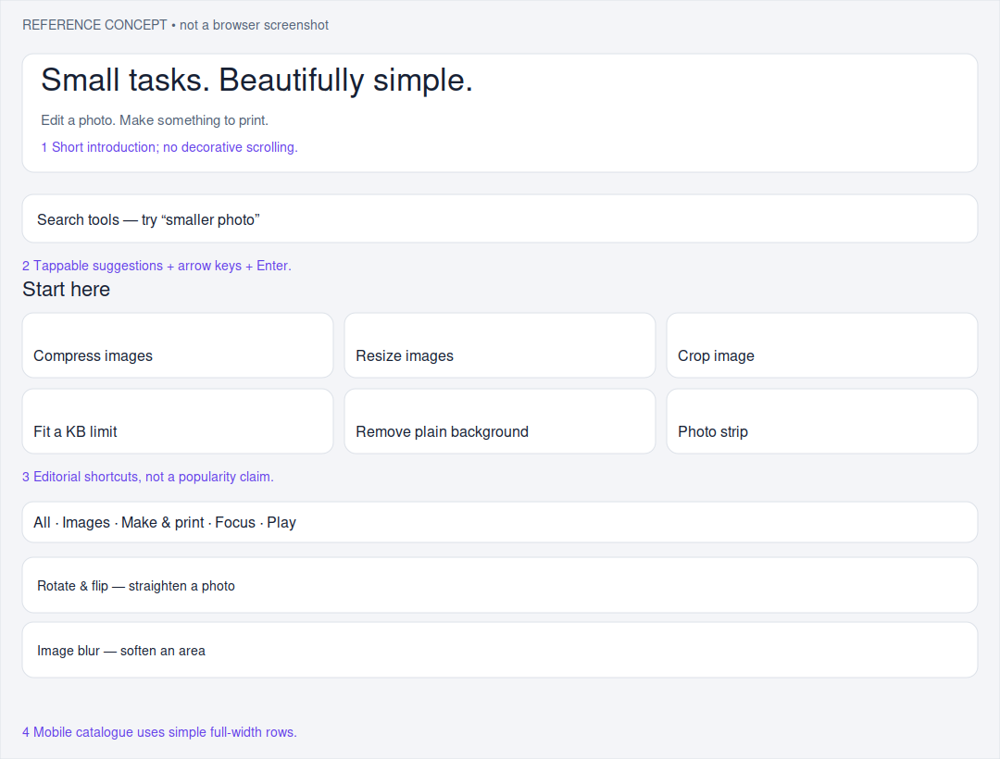
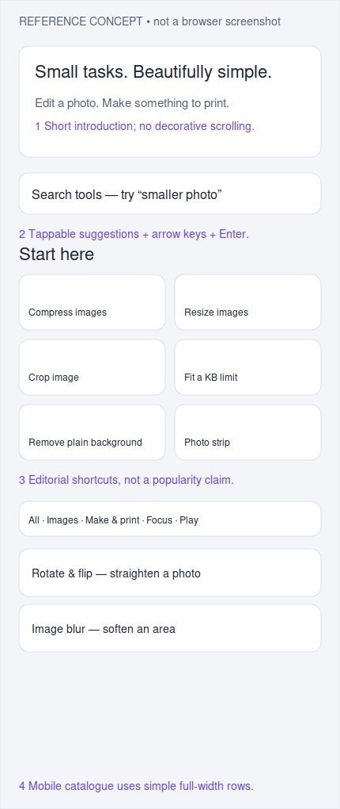
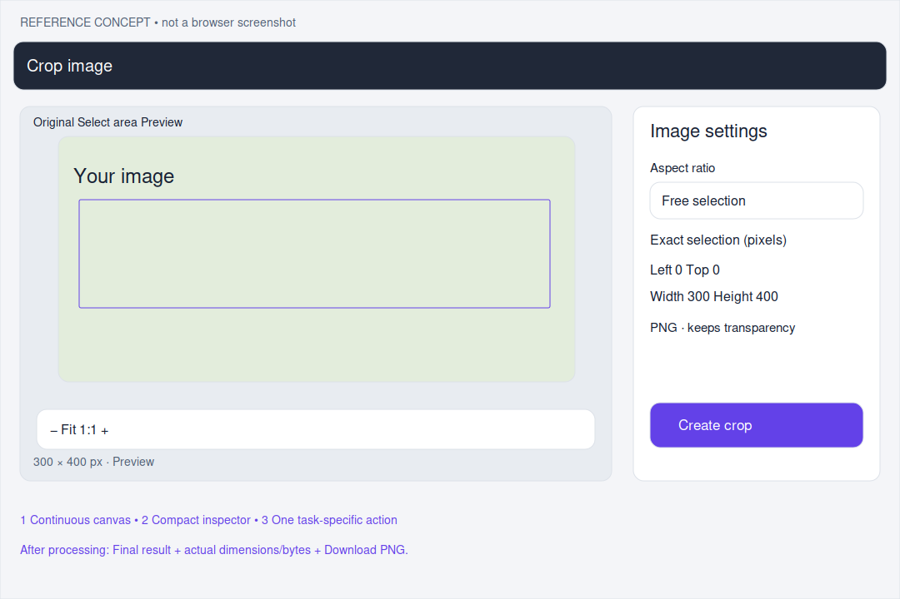
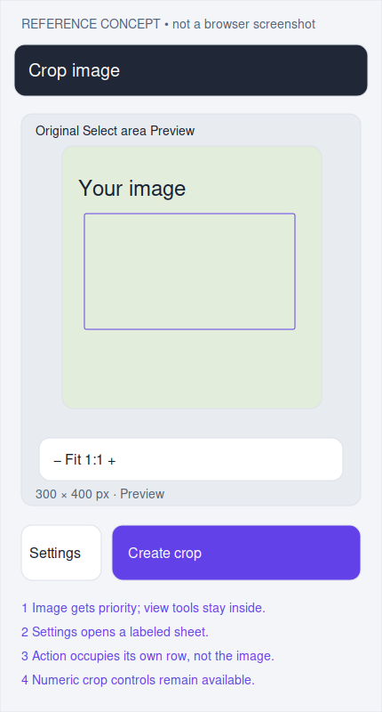

# Lab and Image Studio: review stage

This is an implemented first stage, not a claim that the complete redesign or every desktop/mobile journey has been verified. Keep this PR draft until the new browser UI has been tested. No deployment was performed.

## Scope and inventory

Base: `7df4970dd722d291be3386aacee047ec6ee1b36a` on `main`, inspected 12 October 2026. The live Lab directory showed 37 tools. Source inspection found 50 distinct Lab URLs, including 25 image tools, older/overlapping Lab tasks and the `sketch-pdf` redirect. Counts reflect source registries plus the two explicit route files, not an assumed catalog size. See [inventory](inventory.json) and [every-tool review matrix](tool-matrix.csv).

Only Lab discovery and the shared image UI changed. `/tools`, PDF processors, existing Lab PDF experiments, dependencies and existing URLs are unchanged. No new codecs, AI background removal or lossless-compression promise was introduced. Older `docs/image-studio-design-research.md` contains claims about an earlier implementation; those are **not** verification evidence for this change.

## Problems, in priority order

1. **Confirmed desktop feedback gap — compression can increase size.** A 700×900 WebP fixture (11,584 bytes) exported as a 26,927-byte JPEG. Production displayed the size and “1 file ready”, without explicitly saying compression had not reduced it. The processor is not being replaced: the new UI calculates reduction from actual encoded bytes, or displays “No size reduction” with a useful next step.
2. **Confirmed source concern — mobile controls hide meaning.** Previous `image-tools.css` made Add Images text `font-size: 0`, hid Replace, used 10–12px view labels, and exposed settings through an icon. The new mobile action row has a visible Settings button; Add Images and Choose New Images remain labeled. This is source evidence, not a mobile runtime test.
3. **Confirmed desktop copy problem — generic operations and download.** Rotate, grayscale and several conversions used “Create result”; single outputs used “Download result”. Actions now name the task, downloads name the actual extension, and final-result copy no longer calls pixels “downloaded” before the user downloads them. A browser click is reported as “Download started”, not a guarantee that a file was saved.
4. **Discovery recommendation — decorative space precedes task selection.** The live homepage had a large illustration/intro and a separate search section, then equally prominent cards. The shorter intro, prominent search, six editorial shortcuts and simpler mobile rows prioritize the choice users came to make. The shortcuts are justified by distinct everyday tasks (compression, dimensions, crop, form limits, plain background and a photo strip), not invented popularity data.
5. **Source inventory concern — discoverability is narrower than routing.** Curated discovery omits older experiments and overlapping printable tools. Their URLs remain available. The matrix distinguishes these from the active 37-card directory; introducing every legacy duplicate into the main grid would increase confusion. Related-task navigation for these is a later decision.

## Implemented discovery

- Existing 37 catalog entries and URLs retained.
- Search matches words across names, descriptions and task synonyms. “smaller photo” finds compression. Search ignores the active category so a relevant tool cannot be hidden by an earlier filter.
- Up to five query suggestions, arrow-key navigation, Enter activation and Escape dismissal. Native links preserve the repository's existing browser-navigation behavior.
- Combobox/listbox relationships, selected-option state and a polite result count. No automatic navigation on focus or first keystroke.
- Six “Start here” shortcuts; two columns on mobile, three on desktop. Full mobile catalog becomes one tool per row.
- One compact horizontally scrollable category strip; counts outside the buttons; empty-search suggestions and a reset path.
- Theme variables preserve light/dark styling. Restrained focus and hover states; no continuous decorative animation.

## Shared workspace and exceptions

`ImageWorkspace` continues to own desktop canvas/inspector layout and a native mobile settings dialog. `ImageViewport` owns source-pixel gestures, fit, actual size, zoom and pan. `ImageToolSettings` retains task-specific/numeric controls. `ImageLabStudio` owns originals, previews, processing, output blobs, cancellation, retry and batch state. `ImageSizeStudio` uses the same shell with its existing KB-fit engine.

This stage makes labels and touch controls more readable, adds a separate mobile Settings/action row, retains originals and task-specific controls, names processing/download actions, and improves actual size feedback. The settings dialog returns focus to its visible launcher. Short-height layouts allow scrolling instead of shrinking controls to fit. Panels and long download lists can scroll; actions do not overlay the image.

Exceptions retained:

- Crop/blur/pixelate/passport: selection handles, aspect ratios and exact numeric rectangle controls.
- Background removal: plain-color sampling and restoration, with no AI claim.
- Compression/conversion: format, quality, transparency/background consequences and encoded sizes.
- KB reducer: separate target-size solver, actual pixel/byte changes and target failure.
- SVG: sanitization and SVG text/report outputs, not just a bitmap preview.
- Favicon/contact sheet/passport: multiple files, manifest paths, ordering and print-sheet previews.
- Color picker: numeric sampling and text/clipboard result.
- Secret message: hide/read modes, password errors, capacity and PNG carrier requirements.
- Printables, timer, study tools and creative canvases: unchanged task-specific editors; do not force them into an image-upload workflow.

## Annotated concepts

These are layout references, **not screenshots of a working or deployed revision**. Their core hierarchy corresponds to the implemented stage; detailed gesture controls and task panels remain in the real components.

| Discovery desktop | Discovery mobile |
|---|---|
|  |  |

| Workspace desktop | Workspace mobile |
|---|---|
|  |  |

Editable SVG references are alongside the PNGs.

## Competitor research: observation vs claim

Research performed on 12 October 2026; no paid/account features or comparative export-quality benchmark were tested.

| Source | Evidence level | Useful pattern and decision |
|---|---|---|
| [Squoosh](https://squoosh.app/) | Live sample editor observed: original/MozJPEG panes, resize switch, quality slider, advanced settings, 2.79MB original, 862kB result and 69% reduction. No competitor download benchmark. | Actual bytes and reduction after encoding; direct Original/Preview/Final states. Retain existing codecs rather than imply MozJPEG/AVIF support. |
| [iLoveIMG compression](https://www.iloveimg.com/compress-image) | Live entry page observed: explicit task, supported formats, Select Images, drop area and cloud options. Batch efficiency is documented, not independently benchmarked. | A prominent task-specific upload/action; keep local Add Images reachable. Do not copy remote/cloud upload features. |
| [TinyPNG](https://tinypng.com/) | Live public entry/navigation inspected. Compression/format capabilities on the landing page are vendor claims. No exported competitor file inspected. | Focused optimization story and clear format identity. No unsupported “always smaller” or “lossless” language. |
| [Canva image resizer](https://www.canva.com/features/image-resizer/) and [crop help](https://www.canva.com/help/resize-and-crop/) | Public landing page observed; crop/drag interaction is official documentation, not an authenticated editing journey. | Direct manipulation with understandable task naming; numeric alternatives remain essential. No branding/templates copied. |
| [Adobe Express background help](https://helpx.adobe.com/ae_en/express/web/image-creation-and-editing/edit-images/remove-background.html) | Official documentation reviewed. Attempted Express landing URL redirected to Firefly; no usable Express editor journey observed. | Make background/transparency consequence explicit. PDF Studio's plain-color remover must not claim Adobe-style subject detection. |
| [Photopea workspace](https://www.photopea.com/learn/workspace) and [open/save](https://www.photopea.com/learn/opening-saving) | Official workspace documentation inspected. Advanced editor interactions not independently tested. | Large central working area plus contextual right controls; distinguish exporting a finished image from project editing. Avoid a redundant layer-tool rail. |
| [remove.bg](https://www.remove.bg/) and [preview/full-size guidance](https://www.remove.bg/help/a/how-to-use-general-settings.zst) | Live landing/upload page observed. Resolution limits and preview/download distinctions are vendor documentation. No AI cutout quality comparison. | Preview is not the final file; disclose final resolution and format. No preview upscaling or invented full-resolution result. |

[WAI combobox guidance](https://www.w3.org/WAI/ARIA/apg/patterns/combobox/) informed search semantics. [Dragging movements](https://www.w3.org/WAI/WCAG22/Understanding/dragging-movements.html) informed numeric alternatives. [Target size guidance](https://www.w3.org/WAI/WCAG22/Understanding/target-size-minimum.html) informed touch spacing; 44px is this design's target, not a claim that AA universally requires 44px.

## Verification for this revision

Passed locally:

- Repository TypeScript (`npx tsc --noEmit`).
- Repository zero-warning ESLint (`npm run lint`).
- Production build (`npm run build:public`); existing dynamic-import/chunk warnings remain.
- `checks/verify-image-lab.mjs`: genuine formats, crop/resize/rotation dimensions, transparency, grayscale, passport dimensions, ICO/manifest paths, encrypted Unicode message round trip, wrong-password rejection, metadata payload preservation, memory/selection limits.
- `checks/verify-image-size.mjs`: real JPEG outputs below 50/200/300KB, pixel limits, aspect ratio, PNG transparency, invalid input and cancellation.
- `checks/verify-lab-visual.mjs`, `checks/verify-lab-design.mjs`, `checks/verify-daily-mood-canvas.mjs`: existing processing/SSR, layout-independent Lab logic and actual drawing pixels.
- Diff whitespace checks. Mockup PNGs rendered and visually inspected.

Production baseline browser observations (these do **not** prove the new layout): decoded downloads for compression, crop (300×400), resize (300×386), plain background removal (alpha 0–255), rotation and grayscale. JPG-to-PNG and PNG-to-JPG produced download events but their files were not available for independent inspection; those are unverified. These conversion attempts used WebP alternate input, not canonical JPG/PNG fixture journeys. Remaining baseline tools were not run end-to-end in this stage.

The new UI has not been exercised end-to-end in a browser. The available cloud browser does not expose viewport/mobile emulation and cannot access this container's localhost. The normal local dev server also failed in this environment with `uv_interface_addresses` after Cloudflare setup; the production build succeeds. No site was deployed to create an artificial test environment.

Still required before ready-for-review/merge:

- Every changed image tool: desktop and mobile upload → adjust → preview → process → real download → restart.
- 320px/narrow landscape, browser zoom, long filenames, multiple files, large/invalid inputs, cancellation and retry.
- Keyboard search selection, settings dialog focus return, touch crop/restore and numeric alternatives in the new UI.
- Screen-reader status/errors; light/dark contrast measurements; reduced motion and focus visibility.
- iOS/Safari and Android hardware checks.
- First-time usability with older adults where participants are available. No participant study or WCAG compliance claim has been made.

## Reviewable implementation phases

1. **Reliability and language (implemented):** task/format actions, actual compression feedback, accurate download-start wording; retain original processors and regression checks.
2. **Shared discovery/layout (implemented, browser verification pending):** search suggestions, editorial shortcuts, compact mobile rows/categories, labeled Settings and reachable actions, readable controls.
3. **Individual tools (preserved; further redesign pending):** verify every exception and add tool-specific improvements only after observing failures. Complete the per-tool matrix with output evidence; do not treat source inspection as a passed journey.
4. **Accessibility and usability (pending runtime validation):** keyboard/assistive technology, contrast/zoom/narrow screens/reduced motion; participant task completion with older adults.

Premium here means calm composition, readable hierarchy, consistent spacing and controls, accurate states and reliable results. It is not an accessibility certification or a decorative-gradient claim.
